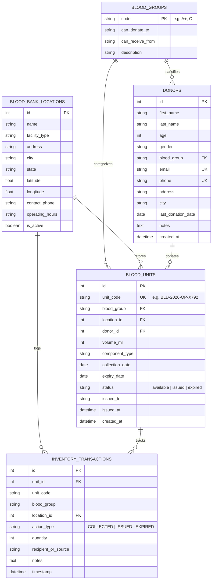

# 🩸 BloodBank Live™ — Management & Inventory System

A full-stack healthcare inventory and donor-tracking system built with **FastAPI**, **SQLAlchemy**, **SQLite**, **WebSockets**, and an interactive **OpenStreetMap / Leaflet.js** frontend.

Designed with clinical-grade validation, real-time inventory synchronization across multi-facility blood banks, duplicate donor detection, 56-day clinical donation interval enforcement, and geospatial proximity search.

---

## 🌟 Key Features

1. **Live Tracking of Blood Inventory**:
   - Real-time tracking of all 8 human ABO/Rh blood groups: **A+**, **A−**, **B+**, **B−**, **AB+**, **AB−**, **O+**, **O−**.
   - Instant bi-directional push updates over **WebSockets** whenever units are collected, issued to clinics, or expired.
   - Visual low-stock alert thresholds ($\le 5$ units) and blood group compatibility helpers (universal RBC donors, universal plasma donors).
   - Full audit trail of all inventory transactions.

2. **Donor Records & Clinical Eligibility**:
   - Stores donor records: name, age, gender, contact details (email, phone, address, city), blood group, and last donation date.
   - Dynamic clinical eligibility calculation based on WHO & Red Cross standards:
     - Minimum 56-day resting interval between whole blood donations.
     - Age safety criteria (18 – 65 years).
     - Countdown badge indicating remaining days until eligible if temporarily restricted.
   - Click-to-inspect donor profile with comprehensive lifetime donation history.

3. **Donor Registration with Duplicate Detection**:
   - Web registration form with client-side & server-side validation.
   - Strict duplicate detection: checks incoming email and phone number against existing database records, returning an HTTP `409 Conflict` error with a clear message identifying the duplicate.

4. **Nearby Blood Bank Locations & India Map**:
   - Locates nearest blood banks across India using browser HTML5 Geolocation (`navigator.geolocation`) or search by **specific Indian locality, area, pincode, or landmark** (e.g. *Connaught Place*, *Indiranagar*, *Andheri West*, *Pincode 110029*, *Banjara Hills*, *Salt Lake*).
   - Instant geocoding via `/api/locations/geocode` with zero API keys required.
   - Calculates great-circle spherical distances using the **Haversine formula** (both kilometers and miles).
   - Displays real-time available stock breakdown per blood group for every individual donation center.
   - Interactive Leaflet.js map with OpenStreetMap tiles centered on India, featuring quick city selectors for **Delhi NCR**, **Mumbai**, **Bengaluru**, **Hyderabad**, **Chennai**, **Kolkata**, and **Pune**.

5. **Live Emergency Transit / Courier Tracking**:
   - Real-time GPS movement of emergency blood transport on the India Map.
   - Live telemetric HUD showing cold-chain storage temperature (`+3.8°C`), speed (`44 km/h`), cargo reserve units (e.g., `2x O− Negative`), and live destination ETA countdown.
   - Live continuous GPS follow mode tracking user movement dynamically.

---

## 🏗️ Architecture & Technology Stack

| Layer | Technology | Justification |
| :--- | :--- | :--- |
| **Backend** | Python 3 + FastAPI | High-performance async ASGI framework with automatic OpenAPI documentation, native WebSocket support, and Pydantic v2 type safety. |
| **Database** | SQLite + SQLAlchemy 2.0 | Zero-configuration ACID-compliant relational persistence with explicit foreign key cascades (`PRAGMA foreign_keys = ON`), easily swappable to PostgreSQL or MySQL. |
| **Real-Time** | WebSockets (`/api/inventory/ws`) | Event-driven, low-overhead push mechanism. Avoids repetitive HTTP polling overhead when multiple clinical staff operate inventory simultaneously. Automatic heartbeat and fallback polling are included for resilience. |
| **Geospatial** | Haversine Formula + Leaflet.js | Calculates spherical distance directly in Python without requiring PostGIS extensions. Uses Leaflet with OpenStreetMap tiles so the application runs immediately offline/locally without requiring Google Maps API keys or credit cards. |
| **Frontend** | Vanilla ES6+ & Tailwind CSS | Zero build-step Single Page Application (SPA). No Node.js or Webpack compilation needed; runs directly upon starting the Python server. |

---

## 📊 Relational Data Model



---

## ⚡ Quickstart & Running the Application

### 1. Prerequisites
- Python 3.10+ (tested on Python 3.14)

### 2. Install Dependencies
```bash
py -m pip install -r requirements.txt
```

### 3. Launch the Server
```bash
py run.py
```
*(Or directly using Uvicorn: `py -m uvicorn app.main:app --host 127.0.0.1 --port 8000 --reload`)*

### 4. Access the Application
- **Web Application**: [http://127.0.0.1:8000](http://127.0.0.1:8000)
- **Interactive Swagger API Docs**: [http://127.0.0.1:8000/docs](http://127.0.0.1:8000/docs)
- **ReDoc API Documentation**: [http://127.0.0.1:8000/redoc](http://127.0.0.1:8000/redoc)

---

## 🧪 Running Automated Tests

Run the comprehensive test suite with `pytest`:
```bash
py -m pytest tests/ -v
```

Tests cover:
- ✅ **Inventory Summary**: Validates counts for all 8 blood groups and low-stock flagging.
- ✅ **Unit Lifecycle**: Adding a unit, issuing it to a hospital, and preventing duplicate issuance.
- ✅ **Donor Registration**: Validates required fields, age bounds, and blood groups.
- ✅ **Duplicate Detection**: Verifies HTTP 409 Conflict rejection for duplicate email and phone numbers.
- ✅ **Clinical Eligibility Service**: 56-day whole blood interval and age restriction checks.
- ✅ **Geospatial Distance Algorithm**: Validates spherical Haversine formula against real-world landmarks.
- ✅ **Nearby Locations Endpoint**: Coordinate queries, radius filters, and stock breakdown per facility.

---

## 🔌 Core API Endpoints

### 1. Blood Inventory & WebSockets
- `GET /api/inventory/summary`: Current counts for all 8 blood groups + low stock flags.
- `GET /api/inventory/units`: Paginated blood units with status and group filters.
- `POST /api/inventory/units`: Collect/add a new blood unit (broadcasts live via WebSocket).
- `POST /api/inventory/units/{unit_id}/issue`: Issue unit to hospital/clinic (broadcasts live via WebSocket).
- `GET /api/inventory/transactions`: Audit trail of recent inventory transactions.
- `GET /api/inventory/blood-groups`: Reference data and compatibility mapping for ABO/Rh groups.
- `WS  /api/inventory/ws`: WebSocket channel for real-time live inventory events.

### 2. Donors & Eligibility
- `GET /api/donors`: Search and filter registered donors with calculated eligibility status.
- `GET /api/donors/{id}`: Detailed profile for a specific donor.
- `GET /api/donors/{id}/history`: Complete lifetime donation history.
- `POST /api/donors`: Register a new donor (with duplicate detection on email and phone).
- `PUT /api/donors/{id}`: Update donor information.

### 3. Locations & Geospatial Proximity
- `GET /api/locations`: List of active blood bank locations.
- `GET /api/locations/nearby`: Search facilities sorted by distance to user coordinates (`lat`, `lng`), including radius filter (`radius_km`), blood group stock availability, and inventory breakdown.
- `GET /api/locations/{id}`: Detailed view of a single facility.
- `POST /api/locations`: Register a new blood bank facility.

---

## 🗺️ Geospatial Maps API Configuration

- **Default (Zero Setup)**: The system comes pre-configured with **Leaflet.js** and **OpenStreetMap** tile servers. No API keys, accounts, or billing configuration are required.
- **Optional Google Maps / Mapbox**:
  If your organization requires Google Maps or Mapbox tiles instead, replace the tile layer URL in [static/js/locations.js](file:///C:/Users/Student/.gemini/antigravity/scratch/blood-bank-system/static/js/locations.js) with your preferred provider and set your API key as an environment variable (`MAPS_API_KEY`).

---

## 📂 Project Directory Structure

```text
blood-bank-system/
├── app/
│   ├── __init__.py               # Application package definition
│   ├── config.py                 # Clinical constants & configuration
│   ├── database.py               # SQLite engine & session dependency
│   ├── models.py                 # SQLAlchemy relational data models
│   ├── schemas.py                # Pydantic v2 validation & response models
│   ├── services.py               # Eligibility, Haversine & duplicate detection
│   ├── websocket_manager.py      # Real-time WebSocket connection manager
│   ├── seed_data.py              # Clinical bootstrap & initial demo data
│   ├── main.py                   # FastAPI app, CORS, routers, static mount
│   └── routers/
│       ├── __init__.py
│       ├── inventory.py          # Inventory & WebSocket endpoints
│       ├── donors.py             # Donor registration & directory
│       └── locations.py          # Proximity search & stock breakdown
├── static/
│   ├── index.html                # Single-Page Application UI
│   ├── css/
│   │   └── style.css             # Healthcare UI styles & animations
│   └── js/
│       ├── app.js                # Router, toast alerts, API client
│       ├── inventory.js          # Live inventory counters & WebSocket client
│       ├── donors.js             # Donor directory & registration forms
│       └── locations.js          # Geolocation, Haversine query & Leaflet map
├── tests/
│   ├── __init__.py
│   └── test_api.py               # Automated pytest test suite
├── requirements.txt              # Production & test dependencies
├── run.py                        # Local execution launcher
└── README.md                     # Documentation & setup guide
```
